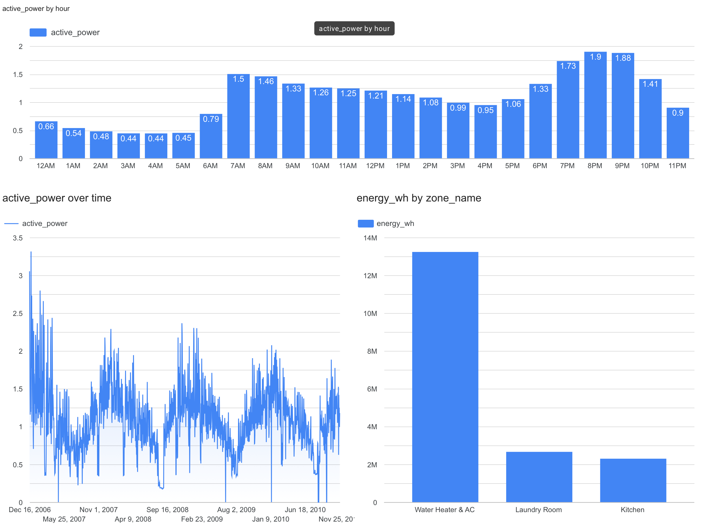
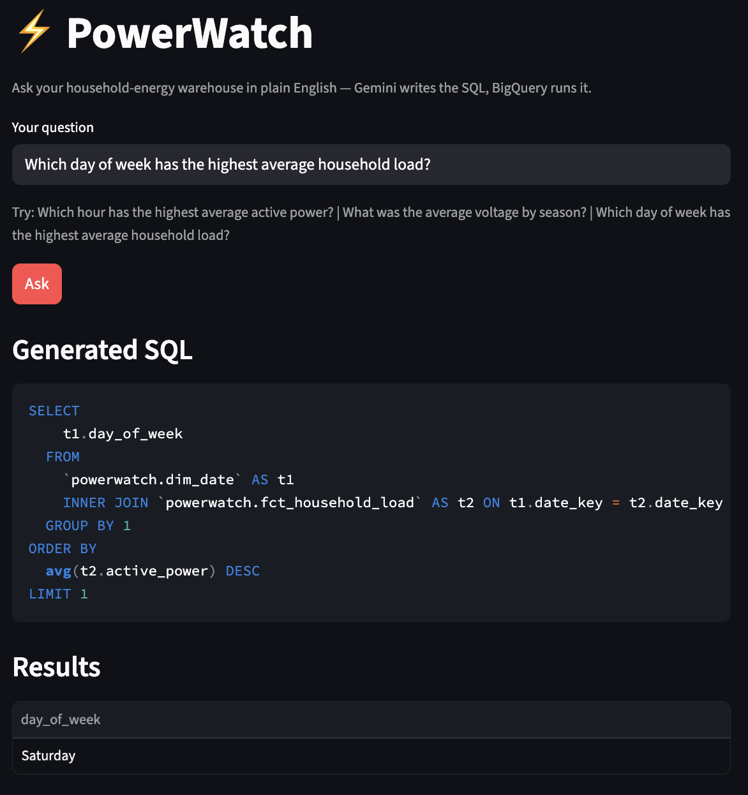

# PowerWatch ⚡

> An end-to-end energy analytics warehouse — raw household consumption data turned into a tested, dimensional model on BigQuery with dbt, surfaced in a live Looker Studio dashboard and queried in plain English via a Vertex AI assistant.


## Overview

PowerWatch turns 2M+ raw household electricity-consumption readings into a clean, queryable **dimensional model**. It implements the Extract → Load → Transform (**ELT**) stages of a modern data product on Google Cloud: raw data is loaded into **BigQuery**, then transformed into a galaxy schema with [dbt](https://www.getdbt.com/).

The project covers the full lifecycle: ingestion → warehousing → dimensional modeling → an interactive **[Looker Studio dashboard](https://lookerstudio.google.com/reporting/a2b135b9-dc45-4445-bb29-be4c45cda0f4)** → a **natural-language → SQL assistant** powered by Vertex AI.

**Why energy data?** Electricity consumption is naturally time-series, multi-dimensional (by zone, time of day, season), and immediately relatable — an ideal canvas for dimensional modeling and OLAP-style analysis.

## What's Built

- **ELT pipeline** — a Python loader lands the full ~2M-row UCI dataset into BigQuery; dbt transforms it in-warehouse (`staging` → `marts`).
- **Galaxy schema** — two fact tables (whole-house load and per-zone energy) sharing conformed `dim_date` and `dim_time` dimensions, optimized for analytical (OLAP) queries.
- **Wide-to-long unpivot** — the three sub-meter columns are melted into the `fct_zone_energy` fact + `dim_zone` dimension. This is the heart of the model.
- **Data contracts** — the raw file is profiled with DuckDB against the UCI documentation and the physics of the meters; dbt tests pin the grain of both facts, the 3-to-1 unpivot ratio, the energy balance, source freshness and the unpivot itself (a unit test); a pytest suite proves the warehouse gives the same answers as the raw file. See [Verification](#verification).
- **Weekly rebuild in CI** — a scheduled GitHub Actions run rebuilds the warehouse from a fresh clone under every contract. Its failure is the alert. See [Verification](#verification).
- **Interactive dashboard** — a live [Looker Studio report](https://lookerstudio.google.com/reporting/a2b135b9-dc45-4445-bb29-be4c45cda0f4) (3 charts) reading from pre-joined reporting views. See [Dashboard](#dashboard).
- **AI query layer** — a **Vertex AI (Gemini)** assistant turns plain-English questions into SQL over the star schema and runs it. See [AI Assistant](#ai-assistant).

## Dashboard

**[▶ View the live Looker Studio dashboard](https://lookerstudio.google.com/reporting/a2b135b9-dc45-4445-bb29-be4c45cda0f4)** (public · view-only)



The dashboard reads from two **pre-joined reporting views** (`rpt_household_load`, `rpt_zone_energy`) built in dbt, so the BI layer queries clean, analysis-ready tables — no in-tool joins or blends. Three views:

- **Average load by hour** — the daily demand curve: an overnight trough (~0.45 kW at 3–5 AM), a morning bump (~1.5 kW at 7–8 AM), and the day's biggest peak in the evening (~1.9 kW at 8–9 PM).
- **Active power over time** — the full 2006–2010 trend, with clear winter-high / summer-low seasonality.
- **Energy by zone** — the water-heater + AC circuit dominates household energy (~13M Wh), far above laundry (~2.7M) and kitchen (~2.3M).

## AI Assistant

Ask the warehouse questions in plain English — a **Vertex AI** Gemini model (`gemini-2.5-flash`) generates BigQuery SQL against the star schema and runs it. The schema is pasted into the prompt (`ai_assistant/prompts/schema_prompt.md`), which keeps the model constrained to real tables and columns rather than hallucinating them.

```
$ python ai_assistant/nl_to_sql.py
Ask PowerWatch: Which zone used the most energy overall?

--- generated SQL ---
SELECT z.zone_name
FROM `powerwatch.fct_zone_energy` f
JOIN `powerwatch.dim_zone` z ON f.zone_key = z.zone_key
GROUP BY 1 ORDER BY SUM(f.energy_wh) DESC LIMIT 1

--- results ---
{'zone_name': 'Water Heater & AC'}
```

It picks the right fact, joins the conformed dimension, and aggregates correctly — e.g. *"which hour has the highest average active power?"* returns `20` (8 PM), matching the dashboard's evening peak. Constraining the model to a **known schema** is what makes NL→SQL reliable.

**Prefer a UI?** `streamlit run ai_assistant/app.py` launches a small web app — type a question and see the generated SQL and results in your browser:



## Tech Stack

| Layer              | Technology                                                | Status  |
| ------------------ | --------------------------------------------------------- | ------- |
| Ingestion          | Python, `google-cloud-bigquery`                           | ✅ built |
| Warehouse          | Google BigQuery                                           | ✅ built |
| Transformation     | dbt (`dbt-bigquery`)                                      | ✅ built |
| Modeling           | Galaxy schema, conformed dimensions, wide-to-long unpivot | ✅ built |
| BI / Visualization | Looker Studio                                             | ✅ built |
| AI assistant       | Vertex AI — Gemini (`gemini-2.5-flash`) via `google-genai`| ✅ built |
| Data contracts     | DuckDB + pytest on the raw file, dbt data/unit tests, source freshness | ✅ built |
| Scheduling         | GitHub Actions weekly rebuild, keyless auth (Workload Identity Federation) | ✅ built |

> The dimensional modeling and ELT patterns here are warehouse-agnostic — the same schema design transfers directly to Snowflake, Redshift, or Databricks.

## Data Model

The source data is measured at **two grains** — whole-house readings every minute, and three sub-metered circuits at that same minute — so PowerWatch uses a **galaxy schema**: two fact tables that share *conformed* `dim_date` and `dim_time` dimensions. Conformed dimensions are what let the two facts be analysed together (e.g. comparing a single zone's draw against total household load at the same moment).


| Table                | Type                | Grain / Description                                                                        |
| -------------------- | ------------------- | ------------------------------------------------------------------------------------------ |
| `fct_household_load` | Fact                | One row per minute. Whole-house measures: active power, reactive power, voltage, intensity |
| `fct_zone_energy`    | Fact                | One row per minute **per zone**. Measure: energy (Wh)                                       |
| `dim_date`           | Conformed dimension | Calendar attributes — day, month, year, weekday, season                                    |
| `dim_time`           | Conformed dimension | Time-of-minute attributes — hour, minute, time-of-day band, peak-hour flag                 |
| `dim_zone`           | Dimension           | The three sub-metered circuits: Kitchen, Laundry, Water-heater & AC (loaded as a seed)     |

**The key transformation:** the raw file stores the three sub-meters as *wide* columns (`Sub_metering_1/2/3`). The dbt model **unpivots** them into *long* form — one row per `(timestamp, zone, energy_wh)` — which is what turns three columns into the `dim_zone` dimension and the `fct_zone_energy` fact.

The model follows dbt's **staging → marts** layering: `staging` parses and cleans the raw source; `marts` builds the analytics-ready facts and dimensions, plus two `rpt_*` reporting views that pre-join the facts to their dims for BI.

One modelling consequence worth knowing: 9 calendar days in the source have no complete reading at all, so `dim_date` holds 1,433 dates, not the 1,442 the file spans.

## Verification

Nothing in this README is taken on trust. Every number is recomputed by an engine that never touches BigQuery, and the warehouse must agree with it.

- **The raw file, with DuckDB** (`tests/test_raw_profile.py`). The expected values come from the [UCI dataset page](https://archive.ics.uci.edu/dataset/235), from arithmetic on the file's own first and last timestamps, and from the physics of the meters: 2,075,259 rows, one per minute from 16/12/2006 17:24 to 26/11/2010 21:02 with no gaps and no duplicates; 25,979 missing readings, all-or-nothing; the UCI energy-balance identity (active power × 1000 / 60 minus the three sub-meters is the unmetered load) never more than one whole-watt-hour pulse per meter below zero in a minute and never negative over an hour; active power never above voltage × intensity by more than one 0.2 A intensity step.
- **The warehouse, with dbt** (`dbt build`, `dbt source freshness`). Unique grain on both facts, exactly three zone rows per reading, the same energy-balance and apparent-power checks on the marts, `not_null` / `unique` on the dimension keys, a `relationships` test to `dim_zone`, a unit test that feeds the unpivot two readings and expects six rows, and a freshness contract on the `_loaded_at` stamp the loader writes to every raw row (warn at 10 days, error at 30).
- **Two engines agree** (`tests/test_golden_answers.py`). Through the assistant's own query path, BigQuery must return the raw file's answers: 2,049,280 complete readings and 6,147,840 zone rows; 2,299,135 / 2,661,031 / 13,235,167 Wh for kitchen, laundry and water-heater & AC; hour 20 as the peak; Saturday as the busiest day. A gated variant asks Gemini for the SQL first (`POWERWATCH_VERTEX_EVAL=1`, paid).
- **A clean machine, weekly** (`.github/workflows/rebuild.yml`). Every Monday a GitHub Actions runner clones the repo, downloads the UCI archive, runs the raw-file contract, reloads BigQuery, runs `dbt build` and `dbt source freshness`, and runs the golden answers. It needs no stored key: `scripts/setup_wif.sh` sets up Workload Identity Federation once.

Every test above was shown failing on a deliberately corrupted input before it passed. The whole suite exists because the demo once died silently: the GCP project runs on the BigQuery sandbox, where every table expires 60 days after it is built, and nothing noticed for 62 days. The incident, its timeline from BigQuery's own job history, and the fixes are in [docs/postmortem-2026-10.md](docs/postmortem-2026-10.md). Decisions are recorded in [docs/adr](docs/adr).

## Project Structure

```
powerwatch/
├── ingestion/            # Extract + Load: pull raw data into BigQuery
│   ├── download_data.py
│   └── load_to_bigquery.py
├── dbt_powerwatch/       # Transform: dbt project (staging + marts)
│   ├── seeds/            # dim_zone — 3-row static dimension
│   └── models/
│       ├── staging/      # stg_power — parse Date+Time, SAFE_CAST, drop missing rows
│       └── marts/        # dims + facts (galaxy schema) + rpt_* reporting views
│   └── tests/            # singular tests: three zone rows per reading, energy balance
├── ai_assistant/         # Vertex AI NL-to-SQL — nl_to_sql.py (CLI) · app.py (web UI) · prompts/
├── tests/                # pytest contracts: raw file (DuckDB), loader stamp, golden answers (BigQuery)
├── scripts/setup_wif.sh  # one-time keyless CI auth setup (Workload Identity Federation)
├── .github/workflows/    # rebuild.yml — weekly rebuild under every contract
├── dashboards/           # Looker Studio dashboard notes
├── GLOSSARY.md           # the project's vocabulary
└── docs/                 # diagrams, dashboard.png, postmortem-2026-10.md, adr/
```

## Getting Started

### Prerequisites

- A Google Cloud project with the BigQuery API enabled. The BigQuery **sandbox** (no billing) is enough to build, with one catch: **every sandbox table expires 60 days after it is built**, and BigQuery refuses any longer expiry. The loader detects this, prints the expiry date, and stops unless you set `ALLOW_SANDBOX=1`. The weekly CI rebuild keeps a sandbox warehouse alive; enabling billing removes the expiry (ADR-0001).
- Python 3.10+
- The `gcloud` CLI, authenticated for Application Default Credentials
- *For the AI assistant only:* a **billing-enabled** project with the **Vertex AI API** (`aiplatform.googleapis.com`) on

### Setup

```bash
# 1. Clone and install
git clone https://github.com/loudiman/powerwatch.git
cd powerwatch
python3 -m venv .venv && source .venv/bin/activate
pip install -r requirements.txt

# 2. Authenticate + configure
gcloud auth application-default login          # dbt + assistant use these credentials
cp .env.example .env                           # set GCP_PROJECT_ID, BQ_DATASET, GCP_REGION
set -a; source .env; set +a                    # export so dbt's env_var() can read them

# 3. Check the raw data before it goes anywhere
python ingestion/download_data.py              # fetches the UCI file if not already present
python -m pytest tests/test_raw_profile.py tests/test_loader_stamp.py

# 4. Load the raw data into BigQuery (add ALLOW_SANDBOX=1 on a sandbox project)
python ingestion/load_to_bigquery.py

# 5. Build and test the warehouse
cd dbt_powerwatch && dbt deps && cp profiles.yml.example profiles.yml
dbt build                                      # models + unit test + data tests
dbt source freshness                           # how old is the raw table?
cd ..

# 6. The warehouse must agree with the raw file
python -m pytest tests/test_golden_answers.py

# 7. (optional) ask the warehouse questions in English — needs billing + Vertex AI API
python ai_assistant/nl_to_sql.py

# 8. (once) keyless weekly rebuild in GitHub Actions — creates the GCP identity pool and repo variables
scripts/setup_wif.sh
```

## Key Learnings

- The data's **two grains** (whole-house vs per-zone) drove the design toward a galaxy schema with conformed `dim_date` / `dim_time` — a reminder that *grain* is the first and most important modeling decision.
- The **wide-to-long unpivot** is what turns three sub-meter columns into a proper dimension + fact — the core move of dimensional modeling.
- **Pre-joining a thin reporting-view layer** in the warehouse beats blending tables in the BI tool — cleaner, reusable across reports, and faster.
- **Constraining an LLM to a known schema** (pasted into the prompt) makes NL→SQL reliable — the model queries real tables, not hallucinated ones.
- dbt's tests turn a pile of SQL into a maintainable, trustworthy pipeline.
- **A warehouse nobody reads raises no errors.** The demo expired on the sandbox and stayed dead for 62 days because nothing queried it and nothing monitored it. A scheduled rebuild under contracts is both the monitor and the fix, and the data's own physics is a better oracle than a screenshot.
- **Measure before you build.** The roadmap carried "incremental models" for a year. The job history showed a full rebuild bills 0.44 GB against a 1 TiB monthly free tier, so the item was closed with an ADR instead of code.

## Roadmap

- **Enable billing on the GCP project** to remove the sandbox's 60-day expiry and its DML ban. Recommended, owner's decision ([ADR-0001](docs/adr/0001-sandbox-versus-billing.md)). Until then the weekly rebuild keeps the warehouse alive.
- **Incremental dbt models: closed, not built.** Measured as not worth it at this data size and impossible on the sandbox ([ADR-0002](docs/adr/0002-no-incremental-models.md)).
- **Scheduled orchestration: done** as a weekly GitHub Actions rebuild. Cloud Composer or Airflow would add nothing at this scale.
- Row-level access controls on the warehouse: still deferred.

---

*Built by [Lou Diamond Morados](https://linkedin.com/in/lou789) — AI/ML Engineer focused on data products and on-device AI.*
