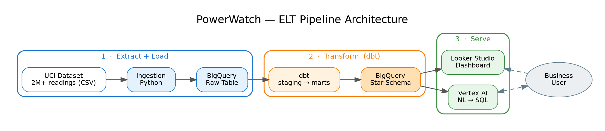
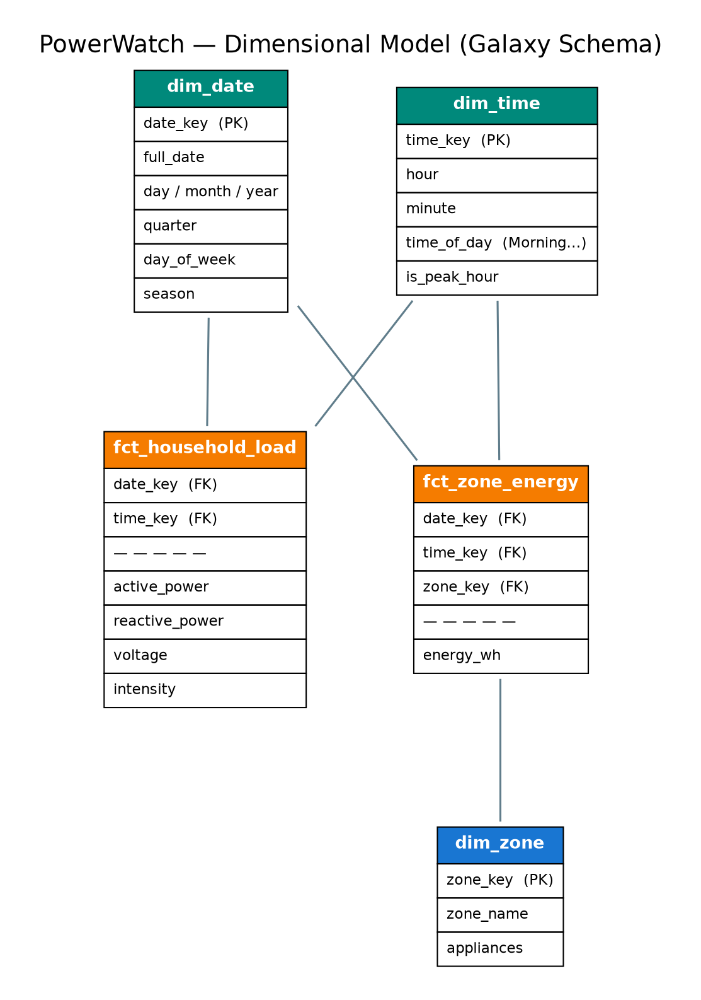

# PowerWatch ⚡

> An end-to-end energy analytics warehouse — raw household consumption data turned into a tested, dimensional model on BigQuery with dbt.



## Overview

PowerWatch turns 2M+ raw household electricity-consumption readings into a clean, queryable **dimensional model**. It implements the Extract → Load → Transform (**ELT**) stages of a modern data product on Google Cloud: raw data is loaded into **BigQuery**, then transformed into a galaxy schema with [dbt](https://www.getdbt.com/).

The project covers the core lifecycle: ingestion → warehousing → dimensional modeling. A Looker Studio dashboard and a Vertex AI natural-language query layer are planned but **not built yet** — see [Roadmap](#roadmap).

**Why energy data?** Electricity consumption is naturally time-series, multi-dimensional (by zone, time of day, season), and immediately relatable — an ideal canvas for dimensional modeling and OLAP-style analysis.

## What's Built

- **ELT pipeline** — a Python loader lands the full ~2M-row UCI dataset into BigQuery; dbt transforms it in-warehouse (`staging` → `marts`).
- **Galaxy schema** — two fact tables (whole-house load and per-zone energy) sharing conformed `dim_date` and `dim_time` dimensions, optimized for analytical (OLAP) queries.
- **Wide-to-long unpivot** — the three sub-meter columns are melted into the `fct_zone_energy` fact + `dim_zone` dimension. This is the heart of the model.
- **dbt tests** — `unique` / `not_null` on the dimension keys plus a `relationships` test from the zone fact to `dim_zone`.

## Tech Stack

| Layer              | Technology                                                | Status         |
| ------------------ | --------------------------------------------------------- | -------------- |
| Ingestion          | Python, `google-cloud-bigquery`                           | ✅ built        |
| Warehouse          | Google BigQuery                                           | ✅ built        |
| Transformation     | dbt (`dbt-bigquery`)                                      | ✅ built        |
| Modeling           | Galaxy schema, conformed dimensions, wide-to-long unpivot | ✅ built        |
| BI / Visualization | Looker Studio                                             | 🔜 roadmap     |
| AI assistant       | Vertex AI (Gemini)                                        | 🔜 roadmap (stub) |

> The dimensional modeling and ELT patterns here are warehouse-agnostic — the same schema design transfers directly to Snowflake, Redshift, or Databricks.

## Data Model

The source data is measured at **two grains** — whole-house readings every minute, and three sub-metered circuits at that same minute — so PowerWatch uses a **galaxy schema**: two fact tables that share *conformed* `dim_date` and `dim_time` dimensions. Conformed dimensions are what let the two facts be analysed together (e.g. comparing a single zone's draw against total household load at the same moment).



| Table                | Type                | Grain / Description                                                                        |
| -------------------- | ------------------- | ------------------------------------------------------------------------------------------ |
| `fct_household_load` | Fact                | One row per minute. Whole-house measures: active power, reactive power, voltage, intensity |
| `fct_zone_energy`    | Fact                | One row per minute **per zone**. Measure: energy (Wh)                                       |
| `dim_date`           | Conformed dimension | Calendar attributes — day, month, year, weekday, season                                    |
| `dim_time`           | Conformed dimension | Time-of-minute attributes — hour, minute, time-of-day band, peak-hour flag                 |
| `dim_zone`           | Dimension           | The three sub-metered circuits: Kitchen, Laundry, Water-heater & AC (loaded as a seed)     |

**The key transformation:** the raw file stores the three sub-meters as *wide* columns (`Sub_metering_1/2/3`). The dbt model **unpivots** them into *long* form — one row per `(timestamp, zone, energy_wh)` — which is what turns three columns into the `dim_zone` dimension and the `fct_zone_energy` fact.

The model follows dbt's **staging → marts** layering: `staging` parses and cleans the raw source; `marts` builds the analytics-ready facts and dimensions.

## Project Structure

```
powerwatch/
├── ingestion/            # Extract + Load: pull raw data into BigQuery
│   ├── download_data.py
│   └── load_to_bigquery.py
├── dbt_powerwatch/       # Transform: dbt project (staging + marts)
│   ├── seeds/            # dim_zone — 3-row static dimension
│   └── models/
│       ├── staging/      # stg_power — parse Date+Time, cast, drop `?` rows
│       └── marts/        # facts + dimensions (galaxy schema)
├── ai_assistant/         # Vertex AI NL-to-SQL — stub only, not yet wired (roadmap)
├── dashboards/           # Looker Studio notes + screenshots (roadmap)
└── docs/                 # architecture & schema diagrams
```

## Getting Started

### Prerequisites

- A Google Cloud project with BigQuery enabled
- Python 3.10+
- A service-account key with BigQuery access

### Setup

```bash
# 1. Clone and install
git clone https://github.com/loudiman/powerwatch.git
cd powerwatch
pip install -r requirements.txt

# 2. Configure credentials
cp .env.example .env
# fill in your GCP project ID + path to service-account key

# 3. Load the raw data into BigQuery
python ingestion/download_data.py     # fetches the UCI file if not already present
python ingestion/load_to_bigquery.py

# 4. Build the warehouse models
cd dbt_powerwatch
cp profiles.yml.example profiles.yml   # add your BigQuery details
dbt deps
dbt build        # runs models + tests (run by hand — no orchestration yet)
```

## Key Learnings

- The data's **two grains** (whole-house vs per-zone) drove the design toward a galaxy schema with conformed `dim_date` / `dim_time` — a reminder that *grain* is the first and most important modeling decision.
- The **wide-to-long unpivot** is what turns three sub-meter columns into a proper dimension + fact — the core move of dimensional modeling.
- dbt's tests turn a pile of SQL into a maintainable, trustworthy pipeline.

## Roadmap

Not built yet — planned next:

- **Looker Studio dashboard** — three charts: household load over time, energy-by-zone bar, and an hour-of-day peak heatmap. Will live in `dashboards/`.
- **Vertex AI NL-to-SQL assistant** — ask questions in plain English; the model generates SQL against the known schema. A minimal stub exists in `ai_assistant/` but is not wired up.
- Incremental dbt models for larger data volumes; scheduled orchestration (Cloud Composer / Airflow); row-level access controls.

---

*Built by [Lou Diamond Morados](https://linkedin.com/in/lou789) — AI/ML Engineer focused on data products and on-device AI.*
